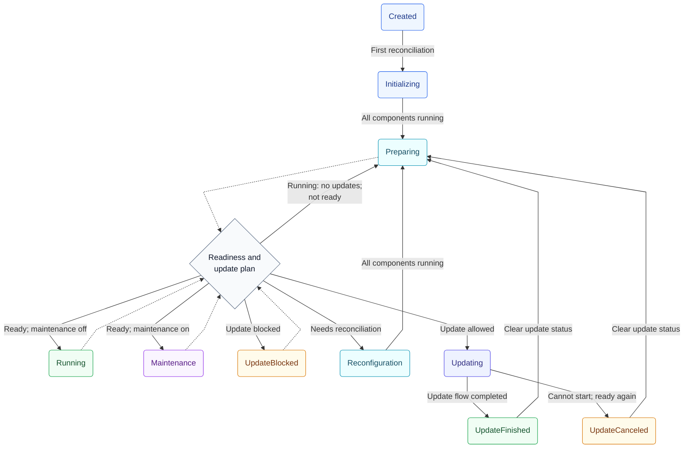

# YTsaurus Kubernetes Operator Guide

This is brief guide for operator, for details look [YTsaurus Admin Guide](https://ytsaurus.tech/docs/en/admin-guide/).

## Cluster States

The operator reports the cluster lifecycle in [`status.state`](api.md#clusterstate).
Solid arrows show state transitions; dotted arrows show the shared checks performed
while reconciling `Preparing`, `Running`, `Maintenance`, and `UpdateBlocked`.
The diamond represents controller logic, rather than an additional cluster state.

| State | What it means |
| --- | --- |
| `Created` | Initial state, also used when `status.state` is empty. The next reconciliation starts initialization. |
| `Initializing` | Create resources and run initialization jobs. Advance once all components are running. |
| `Preparing` | Check readiness and apply the update plan after initialization, reconfiguration, or an update. |
| `Running` | All components are ready and maintenance is disabled. |
| `Reconfiguration` | Reconcile components that are pending, started, or blocked by dependencies. Return to `Preparing` once all components are running. |
| `Maintenance` | Components match the requested maintenance configuration, including scaling selected components to zero according to `spec.clusterMaintenance.shutdown`. |
| `Updating` | Execute the update flow for the selected components. The current step is reported separately in [`status.updateStatus.state`](api.md#updatestate). |
| `UpdateBlocked` | An update is needed, but `UpdateIsPossible` is false or the update plan permits none of the remaining components. Reevaluate when health or the plan changes. |
| `UpdateFinished` | The selected update flow completed. Clear update status and return to `Preparing` to check for remaining work. |
| `UpdateCanceled` | The update flow reached `ImpossibleToStart` after a failed possibility check, then waited for components to be ready. Clear update status and return to `Preparing`. |

“All components running” includes components that need an update; it is less strict
than “all components ready”. The operator checks readiness first, then handles
components that need reconciliation, and only then considers updates. While update
eligibility is unknown or readiness is still pending, the current state may persist.

`UpdateBlocked` keeps the `ReadyToWork` condition true, just like `Running`.
If some components are allowed by the update plan, the operator updates that subset
before reporting any remaining blocked work. Maintenance also participates in these
checks: changing its shutdown setting can require an update or reconfiguration
before reaching `Maintenance` or returning to `Running`.

The transitions follow the [cluster reconciler](../controllers/ytsaurus_controller.go)
and the [update flow](../controllers/update_flow_steps.go).

## Cluster Creation

See [admin guide / install](https://ytsaurus.tech/docs/en/admin-guide/install-ytsaurus),
[config samples](../config/samples), and [operator API reference](api.md).

## Cluster Updating

See [admin guide / update ](https://ytsaurus.tech/docs/en/admin-guide/update/).

## Cluster Maintenance

Set [`spec.clusterMaintenance.shutdown`](api.md#clustershutdown) to temporarily shutdown
parts of a cluster mode according to the work required.

Removing the maintenance setting restores the configured replica counts.

| Mode | Components scaled to zero | Effect |
| --- | --- | --- |
| `Compute` | Exec nodes and YQL agents. | Stops job execution and YQL processing. Masters, storage, schedulers, and controller agents remain running. |
| `Tablets` | Tablet nodes. | Makes dynamic tables and services that depend on them unavailable. Masters, data nodes, and compute components remain running. |
| `ExceptMasters` | All cluster servers except primary and secondary masters, plus the UI. | Keeps master cells running for reconfiguration; HTTP and RPC access to the cluster is unavailable. |
| `Everything` | All cluster servers and the UI. | Shuts down the cluster, including masters. |

### Changing Masters Instance Count

Changing `instanceCount` in [`primaryMasters` or `secondaryMasters`](api.md#mastersspec)
requires `spec.clusterMaintenance.shutdown: ExceptMasters`.
Validation webhook checks that maintenance is enabled in both the previous and
the new resource spec, so enable it in a separate edit before changing the `instanceCount`.

Also operator validates that existing `minReadyInstanceCount` masters instance have quorum after change.

Playbook:

1. Check that the master cells are healthy, enable `ExceptMasters` maintenance,
   and wait for `status.state: Maintenance`. Shutdown remote components.
2. Allow updates for all components whose cluster connection configs change, for
   example with `spec.updatePlan: [{class: Everything}]`. Apply any required
   increase in `minReadyInstanceCount` separately and wait for readiness.
3. Change the instance count and, if needed, the required ready count.
   Configure `affinity.podAntiAffinity` to place peers on different Kubernetes nodes.
   If `hostAddresses` is set, update it in the same edit to contain one address per instance.
4. Wait for cluster state `Maintenance` again. Check masters metrics and logs.
5. Remove `spec.clusterMaintenance`, wait for `Running`, and restore update plan.

During the update, the operator builds read-only master snapshots, restarts the
affected master workloads with the new peer lists, and exits read-only mode.
Progress is reported in `status.updateStatus.state`.

### Adding Secondary Master Cell

Operation requires `spec.clusterMaintenance.shutdown: ExceptMasters`.

When adding the first secondary cell, explicitly set primary cell's roles in `spec.primaryMasters.roles`.
For a primary cell using default roles, set `[cypress_node_host, transaction_coordinator, chunk_host]`.

Choose `cellTag` for new cell, must be unique among all connected clusters, and it cannot be changed later.

Choose master cell [`roles`](api.md#mastercellrole), `roles: []` creates a cell without assigned roles.

Add an entry to [`spec.secondaryMasters`](api.md#mastersspec) to extend an existing
cluster with another master cell, initially with `instanceCount: 0`, then increase.

Playbook:

1. Check that the existing master cells are healthy, enable `ExceptMasters`
   maintenance, and wait for `status.state: Maintenance`. Shut down separately
   managed remote components as well.
2. Allow updates for all components whose cluster connection configs change,
   for example with `spec.updatePlan: [{class: Everything}]`.
3. Append the new cell with `instanceCount: 0`, its chosen tag, roles, and storage
   configuration. Preserve the primary roles if this is the first secondary cell.
4. Wait for cluster state `Maintenance`.
5. Set the new cell's `instanceCount` and `minReadyInstanceCount` to the desired value.
   If using fixed `hostAddresses`, add one address per instance in this edit.
6. Wait for `Maintenance` again, after all registration and update passes finish.
   Check masters metrics and logs.
7. Update connection settings for remote components, including
   `RemoteYtsaurus.spec.secondaryMasters`, before restarting them. Remove
   `spec.clusterMaintenance`, wait for `Running`, restore the update plan, and
   resume remote components.

The operator prepares existing masters to accept the new cell, opens registration,
starts the new instances, assigns their configured roles, and completes the cluster
reconfiguration. This involves several read-only snapshot and restart passes.
Keep maintenance enabled until they finish.

Progress is reported in `status.updateStatus.state`.
Maintenance actions are executed by job `yt-master-init-job-default`.

Operator automates plan from [admin guide / extending master servers](https://ytsaurus.tech/docs/en/admin-guide/cell-addition) with some corrections.

## Links

- [Operator API Reference](api.md)
- [YTsaurus Documentation](https://ytsaurus.tech/docs/en/)
- [YTsaurus Admin Guide](https://ytsaurus.tech/docs/en/admin-guide/)
- [YTsaurus Release Notes](https://ytsaurus.tech/docs/en/admin-guide/releases)
